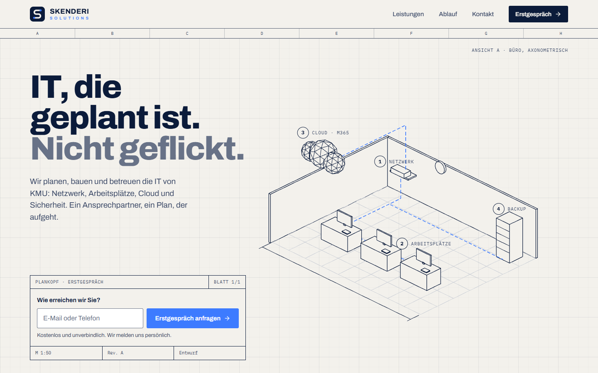
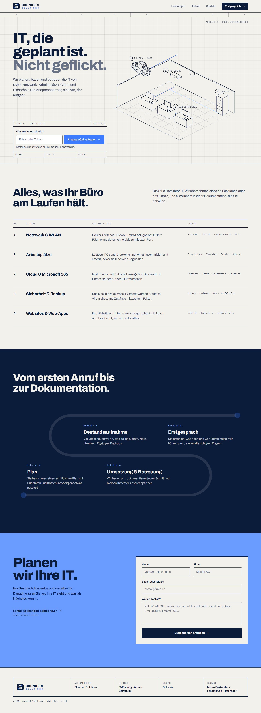
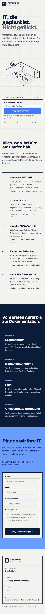

# Skenderi Solutions · Website

Website für **Skenderi Solutions**, IT-Dienstleister für KMU in der Schweiz: Netzwerk, Arbeitsplätze, Cloud & Microsoft 365, Sicherheit & Backup, Websites.

Das Design heisst „Anzeige“: flach und präzise, wie eine Statusanzeige im Serverraum, passend zur Botschaft *„IT, die geplant ist. Nicht geflickt.“*. Papiergrund, Navy aus dem Logo, das Logo-Blau als einzige Signalfarbe, eckige Formen, keine Schatten. Im Hero steht eine Punktmatrix-Anzeige (Canvas), die zwischen dem Logo-S und den vier Bereichen Netzwerk, Arbeitsplätze, Cloud und Sicherheit wechselt. Schriften: Doto (Punktmatrix) und Host Grotesk.



## Screenshots

| Desktop (ganze Seite) | Mobile |
|---|---|
|  |  |

## Highlights

- **3D-Büro im Hero** (React Three Fiber): Netzwerk, Arbeitsplätze, Cloud und Backup als Linienzeichnung, bewegt sich leicht mit der Maus.
- **Stückliste statt Kärtchen**: Fährt man über eine Leistung, leuchtet das passende Bauteil im 3D-Modell auf (und umgekehrt).
- **Ablauf entlang der Logo-Linie**: Das „S“ aus dem Logo zeichnet sich beim Scrollen durch die vier Schritte (Framer Motion).
- **Formulare** mit Validierung, Ladezustand und Toasts (sonner).

## Tech-Stack

Vite · React 19 · TypeScript · Tailwind CSS 4 · Framer Motion · three.js / React Three Fiber / drei · lucide-react · sonner

## Lokal starten

```bash
cd app
npm install
npm run dev
```

Build: `npm run build` (Ausgabe in `app/dist`).

## Offen

- Formulare sind noch nicht an ein Backend angebunden (nur Bestätigung im Browser).
- `kontakt@skenderi-solutions.ch` ist ein Platzhalter.

## Logo

`logo-mark.svg`: geometrisches „S“ als Leiterbahn, Midnight Navy `#0B1B3A` und Signal Blue `#3D7BFF`.

Die ursprünglichen Logo-Entwürfe liegen in `design/logo/` (`logo.html` zeigt das Logo in allen Varianten, `logo-mark.svg` ist das Zeichen).
